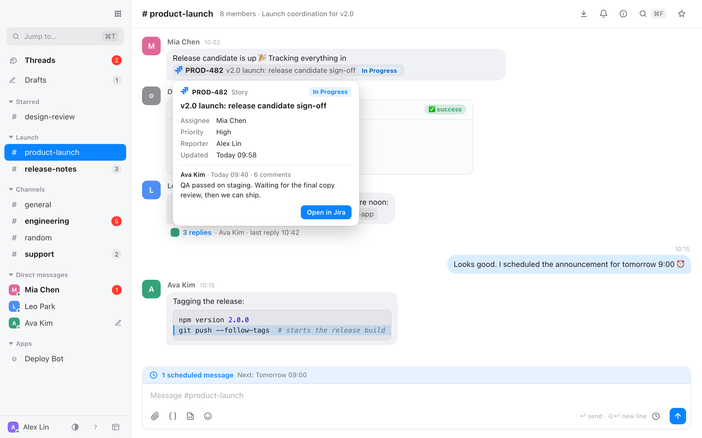
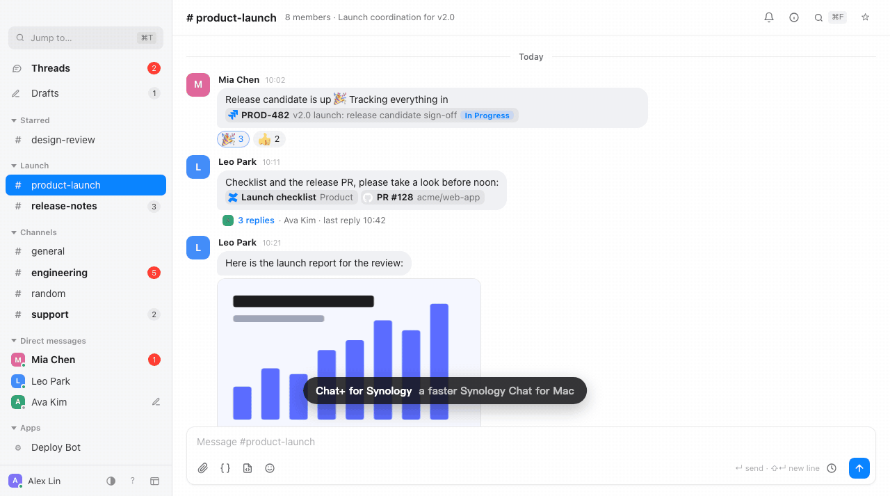
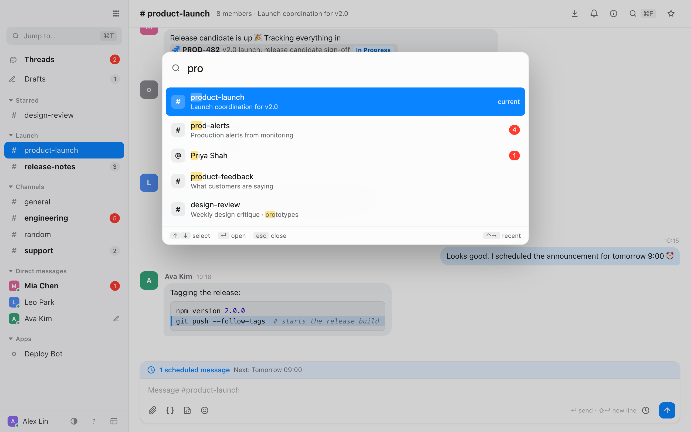
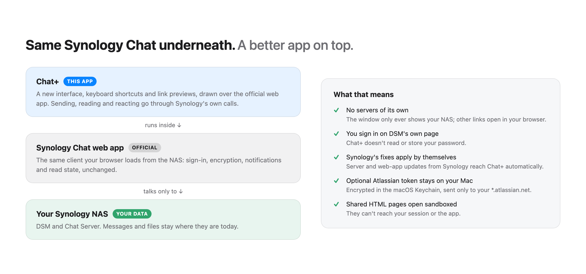

# Chat+ for Synology

**A keyboard-first Mac app for Synology Chat.** Same chat, same NAS, same sign-in. A cleaner interface, real shortcuts and link previews on top.

<picture>
  <source media="(prefers-color-scheme: dark)" srcset="images/hero-dark.png">
  
</picture>

Chat+ opens the Synology Chat web app from your own NAS and draws a new interface over it. Sign-in, messages, encryption and notifications stay with Synology; Chat+ only changes how they look and how fast you get around.

### See it in action



> Chat+ is an independent project. It is not made, endorsed or supported by Synology Inc. Synology and Synology Chat are trademarks of Synology Inc.

## Highlights

**A calmer interface**
- Message bubbles, a resizable sidebar, light and dark themes
- Your own sidebar sections (drag conversations in, fold to unread), drafts that survive restarts
- Bot posts made of `Key: value` lines become cards; runs of bot posts fold together
- A threads inbox across all conversations

**Keyboard first**
- ⌘T jumps to any conversation, unread first · ⌃Tab cycles recent ones
- ⌥↑ / ⌥↓ the conversation above or below · ⌥⇧↑ / ⌥⇧↓ the next one with something unread
- ⌃⌥Space brings Chat+ forward from any app, with the switcher open (change or turn it off in your profile card)
- ⌘F searches this conversation, ⇧⌘F everywhere (`from:` `in:` `has:`) · ⌘/ lists every shortcut

**Links and previews**
- Jira, Confluence, GitHub, Bitbucket, Google Docs and more become tidy chips; long URLs are shortened
- Shared HTML pages, PDFs, CSV tables, audio and video open in place
- With your own Atlassian token (optional): live ticket titles and status, hover cards, whole tickets in the side panel (hover a Jira chip and click its preview button: description, comments and images, next to the chat), a ticket picker (type `PROJ-` to pick one of your issues), and the tickets mentioned in each conversation

**Getting things done**
- Schedule a message for later, set reminders on any message, slash commands as in Synology's own client
- ⌘I shows a conversation's files and links (searchable, by type) and its members, and invites people
- Right-click a message for quick reactions and every message action

<picture>
  <source media="(prefers-color-scheme: dark)" srcset="images/switcher-dark.png">
  
</picture>

## How it works, and why it's safe

<picture>
  <source media="(prefers-color-scheme: dark)" srcset="images/how-dark.png">
  
</picture>

- The window only ever shows your NAS. Other links open in your browser.
- You sign in on DSM's own page; Chat+ doesn't read or store your password.
- Server and web-app updates from Synology reach Chat+ automatically.
- Your DSM sign-in is kept encrypted on disk with a key in your macOS Keychain.
- The optional Atlassian token is encrypted the same way and sent only to the Atlassian site you saved it for.
- Shared HTML pages open in a sandbox with no access to your session.

## Install

1. Download `Chat-Plus-for-Synology-<version>-universal.dmg` from [Releases](../../releases).
2. Optional: check it against `SHA256SUMS.txt` from the same release:
   ```bash
   shasum -a 256 Chat-Plus-for-Synology-*-universal.dmg
   ```
3. Open the disk image and drag **Chat+ for Synology** to Applications.
4. The app isn't notarized by Apple yet, so the first time macOS blocks it: open **System Settings → Privacy & Security** and click **Open Anyway** (or right-click the app → Open).
5. Enter your Chat address, for example `https://nas.example.com/chat/` or `https://example.synology.me:5001/chat/`, then sign in as usual. You can change it later from the app menu.

**Requirements:** macOS 12 or later (Apple silicon or Intel), and a Synology NAS running Synology Chat Server that your Mac can reach.

## Good to know

- **Notifications.** The Dock badge, bounce and sound work out of the box. Allow Chat+ in **System Settings → Notifications** and new messages show as regular notifications with the Chat+ icon; clicking one opens that message. If macOS doesn't show them, turn on pop-up banners in your profile card: they then come through Script Editor, and clicking one still opens the message.
- **Your data stays local.** Sections, drafts, reminders and link settings are kept on your Mac. Nothing is sent anywhere except your NAS, and Atlassian if you add a token.
- **Updates.** Once a day Chat+ asks GitHub whether a newer release exists (it fetches release info only; nothing about you is sent). When there is one, it offers to open the download page; install it by replacing the app, and your settings and sign-in are kept. Use **Check for Updates…** in the app menu any time, or untick **Check for Updates Automatically**.
- **Switching back.** ⌘⇧U toggles Synology's classic interface at any time.

## License

[MIT](LICENSE)
